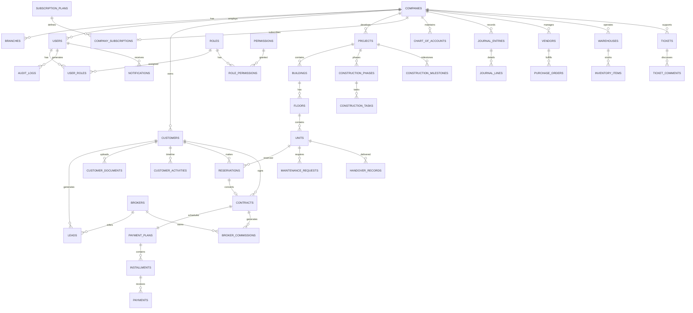

# Entity Relationship Diagram (ERD)
# FRATELANZA REAL ESTATE PLATFORM

## Core Entity Attributes

### companies
`id, name_ar, name_en, code, status, storage_limit_mb, country`

### users
`id, company_id, email, system_role, is_super_admin, status`

### units
`id, floor_id, unit_code, unit_type, area_sqm, price, status, is_locked`

### contracts
`id, company_id, contract_number, customer_id, unit_id, total_price, status`

### installments
`id, payment_plan_id, due_date, due_amount, paid_amount, status`
