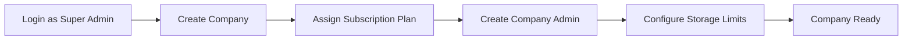
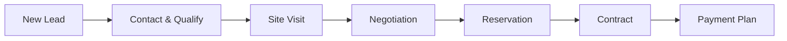

# User Journeys
# FRATELANZA REAL ESTATE PLATFORM

## Journey 1: Super Admin — Onboard New Company

**Steps:**
1. Super Admin logs in at `/login`
2. Navigates to Companies → Add Company
3. Enters company details (Arabic/English names, code, country)
4. Selects subscription plan (Basic/Professional/Enterprise)
5. Creates admin user with email and password
6. Company appears in dashboard with TRIAL/ACTIVE status

## Journey 2: Sales Agent — Lead to Contract

**Steps:**
1. Lead captured (Facebook, walk-in, broker referral)
2. AI scores lead automatically
3. Agent contacts lead, updates stage
4. Customer visits project site
5. Agent creates reservation (unit locked)
6. Manager approves reservation
7. Contract generated (Arabic + English)
8. Payment plan auto-generates installments

## Journey 3: Collection Officer — Overdue Management

1. Open Collections Dashboard
2. View overdue installments (red indicators)
3. Send WhatsApp/SMS reminder
4. Record partial or full payment
5. Customer statement updated automatically

## Journey 4: Broker — Track Commissions

1. Broker logs into Broker Portal
2. Views referred leads and conversions
3. Commission calculated on contract signing
4. Manager approves commission
5. Finance settles payment

## Journey 5: Customer — Self Service

1. Customer logs into Customer Portal
2. Views active contracts and installments
3. Downloads contract PDF
4. Submits maintenance request
5. Tracks complaint status

## Journey 6: Project Manager — Construction Tracking

1. Open Construction module for project
2. Create phases and tasks
3. Assign contractors
4. Update progress percentages
5. Track budget vs actual on Gantt chart
6. Flag delays and risks

## Journey 7: Company Admin — Daily Operations

1. Login → Company Dashboard
2. Review KPIs (sales, collections, units)
3. Check lead pipeline
4. Approve pending reservations
5. Review team performance
6. Generate reports
