# منصة فراتيلانزا — دليل لقطات الشاشة التجريبية (عربي + إنجليزي)

**الجمهور:** العملاء المحتملون لتقييم النسخة التجريبية (بدون المشرف العام)  
**رابط العرض:** https://rs.fratelanza.com/login (العقارات — **ليس** hub.fratelanza.com)  
**تسجيل الدخول:** اسم المستخدم `demo_admin` (أو `admin@demo.fratelanza.com` في الإصدارات الأقدم) · كلمة المرور `Demo123456`  
**عدد الشاشات:** 26

كل لقطة تحتوي على **شرح ثنائي اللغة** (إنجليزي يسار، عربي يمين) يوضح كل ميزة في الصفحة.

> English index: [DEMO-SCREENSHOTS-GUIDE.md](./DEMO-SCREENSHOTS-GUIDE.md)

---

## البدء السريع

1. افتح **https://rs.fratelanza.com/login** وسجّل الدخول بـ `demo_admin`
2. اضغط **تحميل بيانات تجريبية** من لوحة التحكم إذا كانت الجداول فارغة
3. استخدم القائمة الجانبية لفتح كل وحدة أدناه
4. قارن كل لقطة مع جلستك المباشرة

---

## 01. Login — Company User / تسجيل الدخول — مستخدم الشركة

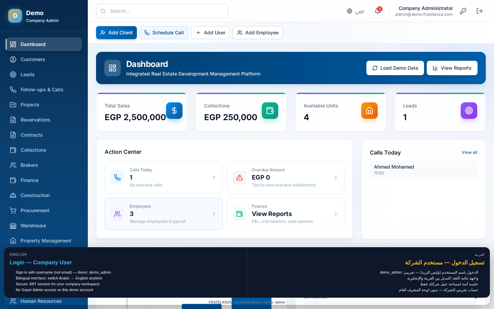

| | |
|---|---|
| **Route** | `/login` |
| **Screenshot** | `00-login.png` |

### English — Features & details

- Sign in with username (not email) — demo: demo_admin
- Bilingual interface: switch Arabic ↔ English anytime
- Secure JWT session for your company workspace
- No Super Admin access on this demo account

### العربية — الميزات والتفاصيل

- الدخول باسم المستخدم (وليس البريد) — تجريبي: demo_admin
- واجهة ثنائية اللغة: التبديل بين العربية والإنجليزية
- جلسة آمنة لمساحة عمل شركتك فقط
- حساب تجريبي للشركة — بدون لوحة المشرف العام

---

## 02. Dashboard — Executive Overview / لوحة التحكم — نظرة تنفيذية

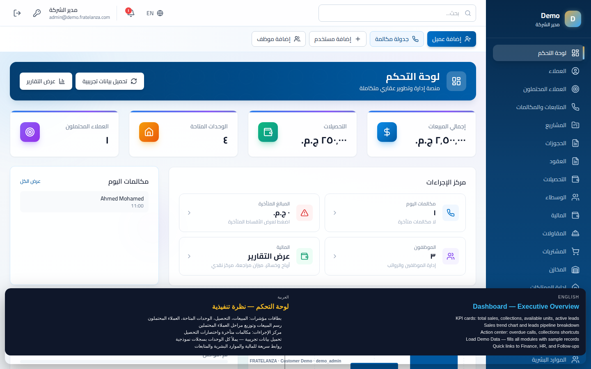

| | |
|---|---|
| **Route** | `/dashboard` |
| **Screenshot** | `01-dashboard.png` |

### English — Features & details

- KPI cards: total sales, collections, available units, active leads
- Sales trend chart and leads pipeline breakdown
- Action center: overdue calls, collections shortcuts
- Load Demo Data — fills all modules with sample records
- Quick links to Finance, HR, and Follow-ups

### العربية — الميزات والتفاصيل

- بطاقات مؤشرات: المبيعات، التحصيل، الوحدات المتاحة، العملاء المحتملون
- رسم المبيعات وتوزيع مراحل العملاء المحتملين
- مركز الإجراءات: مكالمات متأخرة واختصارات التحصيل
- تحميل بيانات تجريبية — يملأ كل الوحدات بسجلات نموذجية
- روابط سريعة للمالية والموارد البشرية والمتابعات

---

## 03. Customers — Full CRM / العملاء — إدارة علاقات كاملة

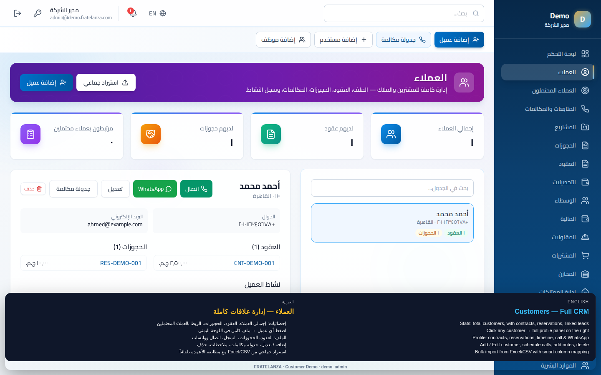

| | |
|---|---|
| **Route** | `/customers` |
| **Screenshot** | `02-customers.png` |

### English — Features & details

- Stats: total customers, with contracts, reservations, linked leads
- Click any customer → full profile panel on the right
- Profile: contracts, reservations, timeline, call & WhatsApp
- Add / Edit customer, schedule calls, add notes, delete
- Bulk import from Excel/CSV with smart column mapping

### العربية — الميزات والتفاصيل

- إحصائيات: إجمالي العملاء، العقود، الحجوزات، الربط بالعملاء المحتملين
- اضغط أي عميل → ملف كامل في اللوحة اليمنى
- الملف: العقود، الحجوزات، السجل، اتصال وواتساب
- إضافة / تعديل، جدولة مكالمات، ملاحظات، حذف
- استيراد جماعي من Excel/CSV مع مطابقة الأعمدة تلقائياً

---

## 04. Leads — Sales Pipeline (Kanban) / العملاء المحتملون — مسار المبيعات

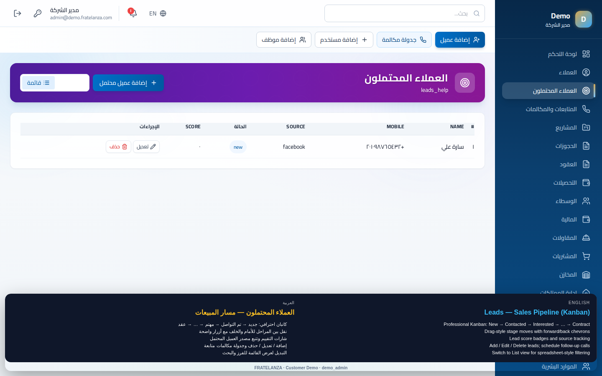

| | |
|---|---|
| **Route** | `/leads` |
| **Screenshot** | `03-leads-kanban.png` |

### English — Features & details

- Professional Kanban: New → Contacted → Interested → … → Contract
- Drag-style stage moves with forward/back chevrons
- Lead score badges and source tracking
- Add / Edit / Delete leads; schedule follow-up calls
- Switch to List view for spreadsheet-style filtering

### العربية — الميزات والتفاصيل

- كانبان احترافي: جديد → تم التواصل → مهتم → … → عقد
- نقل بين المراحل للأمام والخلف مع أزرار واضحة
- شارات التقييم وتتبع مصدر العميل المحتمل
- إضافة / تعديل / حذف وجدولة مكالمات متابعة
- التبديل لعرض القائمة للفرز والبحث

---

## 05. Leads — List View / العملاء المحتملون — عرض القائمة

| | |
|---|---|
| **Route** | `/leads` |
| **Screenshot** | `04-leads-list.png` |

### English — Features & details

- Sortable table with export to Excel
- Columns: name, mobile, stage, score, source, next follow-up
- Row actions: edit, delete, move stage
- Connected to Customers when converted

### العربية — الميزات والتفاصيل

- جدول قابل للفرز مع تصدير Excel
- أعمدة: الاسم، الجوال، المرحلة، التقييم، المصدر، المتابعة القادمة
- إجراءات الصف: تعديل، حذف، نقل المرحلة
- مرتبط بسجل العميل عند التحويل

---

## 06. Follow-ups — Call Queue / المتابعات — قائمة المكالمات

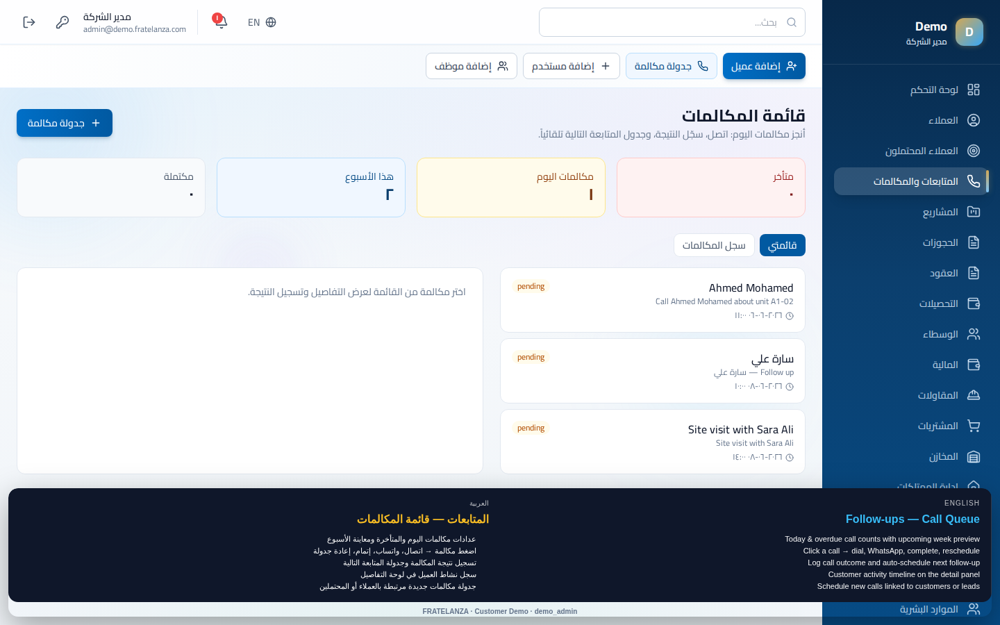

| | |
|---|---|
| **Route** | `/follow-ups` |
| **Screenshot** | `05-follow-ups-queue.png` |

### English — Features & details

- Today & overdue call counts with upcoming week preview
- Click a call → dial, WhatsApp, complete, reschedule
- Log call outcome and auto-schedule next follow-up
- Customer activity timeline on the detail panel
- Schedule new calls linked to customers or leads

### العربية — الميزات والتفاصيل

- عدادات مكالمات اليوم والمتأخرة ومعاينة الأسبوع
- اضغط مكالمة → اتصال، واتساب، إتمام، إعادة جدولة
- تسجيل نتيجة المكالمة وجدولة المتابعة التالية
- سجل نشاط العميل في لوحة التفاصيل
- جدولة مكالمات جديدة مرتبطة بالعملاء أو المحتملين

---

## 07. Follow-ups — Call History / المتابعات — سجل المكالمات

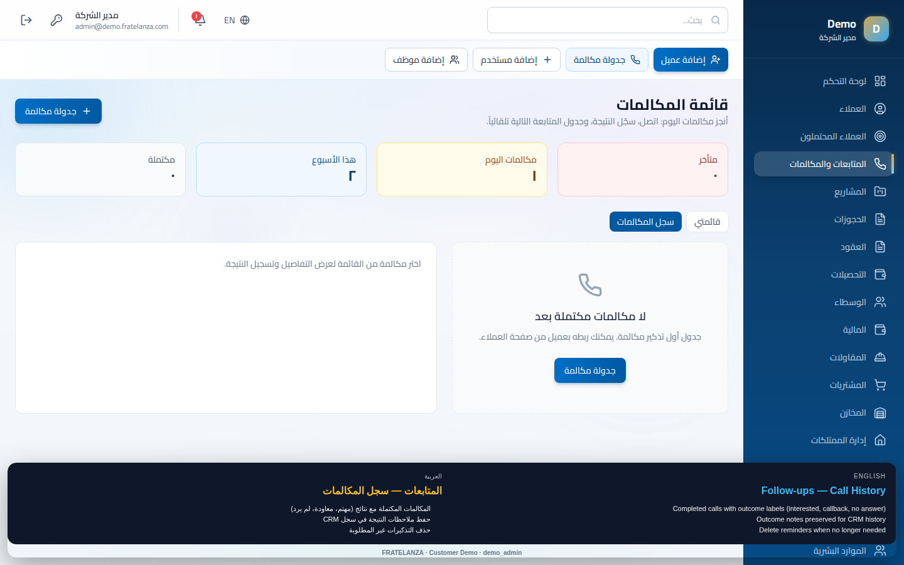

| | |
|---|---|
| **Route** | `/follow-ups` |
| **Screenshot** | `06-follow-ups-history.png` |

### English — Features & details

- Completed calls with outcome labels (interested, callback, no answer)
- Outcome notes preserved for CRM history
- Delete reminders when no longer needed

### العربية — الميزات والتفاصيل

- المكالمات المكتملة مع نتائج (مهتم، معاودة، لم يرد)
- حفظ ملاحظات النتيجة في سجل CRM
- حذف التذكيرات غير المطلوبة

---

## 08. Projects — Overview & Stats / المشاريع — نظرة عامة وإحصائيات

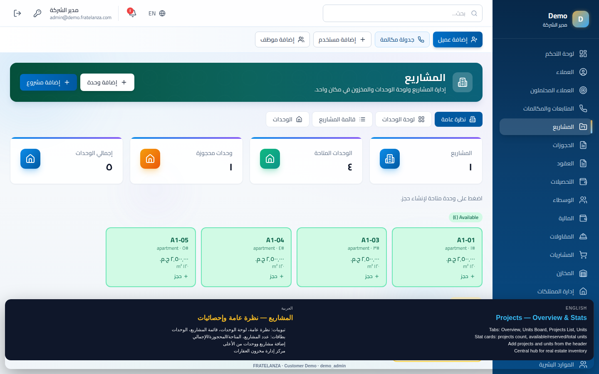

| | |
|---|---|
| **Route** | `/projects` |
| **Screenshot** | `07-projects-overview.png` |

### English — Features & details

- Tabs: Overview, Units Board, Projects List, Units
- Stat cards: projects count, available/reserved/total units
- Add projects and units from the header
- Central hub for real estate inventory

### العربية — الميزات والتفاصيل

- تبويبات: نظرة عامة، لوحة الوحدات، قائمة المشاريع، الوحدات
- بطاقات: عدد المشاريع، المتاحة/المحجوزة/الإجمالي
- إضافة مشاريع ووحدات من الأعلى
- مركز إدارة مخزون العقارات

---

## 09. Projects — Units Board / المشاريع — لوحة الوحدات

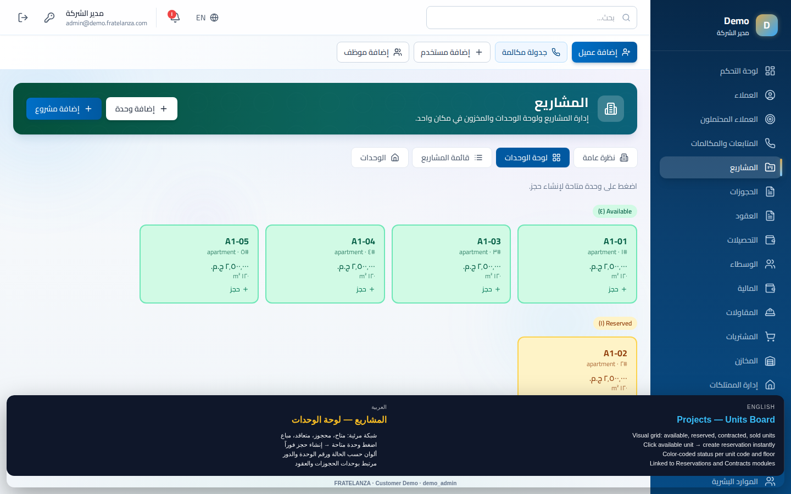

| | |
|---|---|
| **Route** | `/projects` |
| **Screenshot** | `08-projects-units-board.png` |

### English — Features & details

- Visual grid: available, reserved, contracted, sold units
- Click available unit → create reservation instantly
- Color-coded status per unit code and floor
- Linked to Reservations and Contracts modules

### العربية — الميزات والتفاصيل

- شبكة مرئية: متاح، محجوز، متعاقد، مباع
- اضغط وحدة متاحة → إنشاء حجز فوراً
- ألوان حسب الحالة ورقم الوحدة والدور
- مرتبط بوحدات الحجوزات والعقود

---

## 10. Reservations / الحجوزات

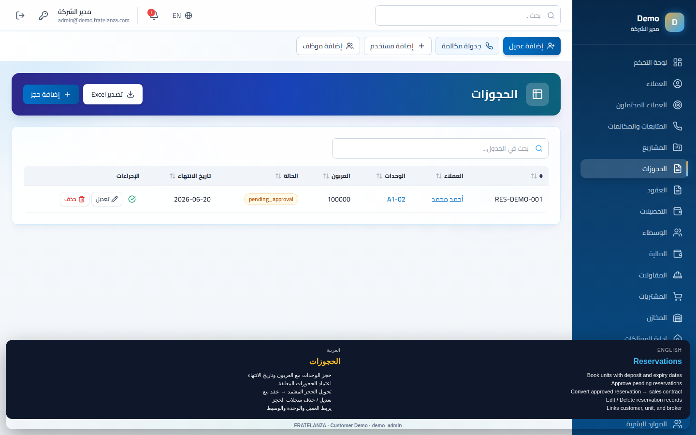

| | |
|---|---|
| **Route** | `/reservations` |
| **Screenshot** | `09-reservations.png` |

### English — Features & details

- Book units with deposit and expiry dates
- Approve pending reservations
- Convert approved reservation → sales contract
- Edit / Delete reservation records
- Links customer, unit, and broker

### العربية — الميزات والتفاصيل

- حجز الوحدات مع العربون وتاريخ الانتهاء
- اعتماد الحجوزات المعلقة
- تحويل الحجز المعتمد → عقد بيع
- تعديل / حذف سجلات الحجز
- يربط العميل والوحدة والوسيط

---

## 11. Contracts — Sales Agreements / العقود — اتفاقيات البيع

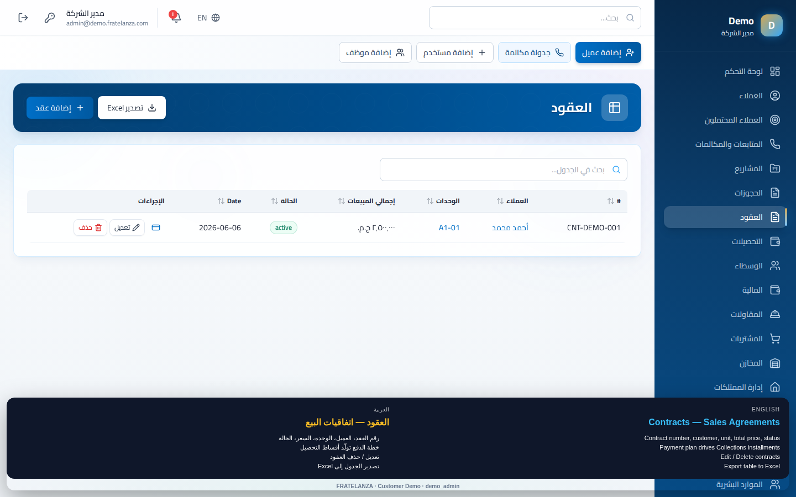

| | |
|---|---|
| **Route** | `/contracts` |
| **Screenshot** | `10-contracts.png` |

### English — Features & details

- Contract number, customer, unit, total price, status
- Payment plan drives Collections installments
- Edit / Delete contracts
- Export table to Excel

### العربية — الميزات والتفاصيل

- رقم العقد، العميل، الوحدة، السعر، الحالة
- خطة الدفع تولّد أقساط التحصيل
- تعديل / حذف العقود
- تصدير الجدول إلى Excel

---

## 12. Collections — Installments / التحصيل — الأقساط

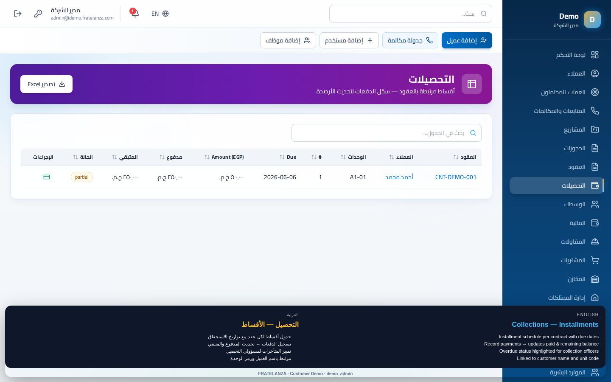

| | |
|---|---|
| **Route** | `/collections` |
| **Screenshot** | `11-collections.png` |

### English — Features & details

- Installment schedule per contract with due dates
- Record payments → updates paid & remaining balance
- Overdue status highlighted for collection officers
- Linked to customer name and unit code

### العربية — الميزات والتفاصيل

- جدول أقساط لكل عقد مع تواريخ الاستحقاق
- تسجيل الدفعات → تحديث المدفوع والمتبقي
- تمييز المتأخرات لمسؤولي التحصيل
- مرتبط باسم العميل ورمز الوحدة

---

## 13. Brokers — Partners & Commissions / الوسطاء — الشركاء والعمولات

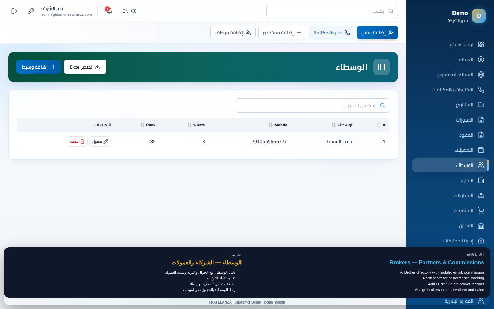

| | |
|---|---|
| **Route** | `/brokers` |
| **Screenshot** | `12-brokers.png` |

### English — Features & details

- Broker directory with mobile, email, commission %
- Rank score for performance tracking
- Add / Edit / Delete broker records
- Assign brokers on reservations and sales

### العربية — الميزات والتفاصيل

- دليل الوسطاء مع الجوال والبريد ونسبة العمولة
- تقييم الأداء للترتيب
- إضافة / تعديل / حذف الوسطاء
- ربط الوسطاء بالحجوزات والمبيعات

---

## 14. Construction — Project Phases / المقاولات — مراحل المشروع

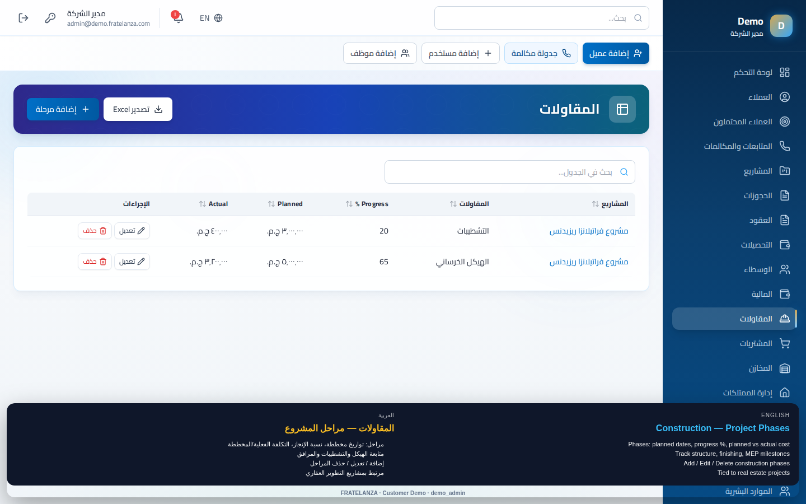

| | |
|---|---|
| **Route** | `/construction` |
| **Screenshot** | `13-construction.png` |

### English — Features & details

- Phases: planned dates, progress %, planned vs actual cost
- Track structure, finishing, MEP milestones
- Add / Edit / Delete construction phases
- Tied to real estate projects

### العربية — الميزات والتفاصيل

- مراحل: تواريخ مخططة، نسبة الإنجاز، التكلفة الفعلية/المخططة
- متابعة الهيكل والتشطيبات والمرافق
- إضافة / تعديل / حذف المراحل
- مرتبط بمشاريع التطوير العقاري

---

## 15. Procurement — Vendors / المشتريات — الموردون

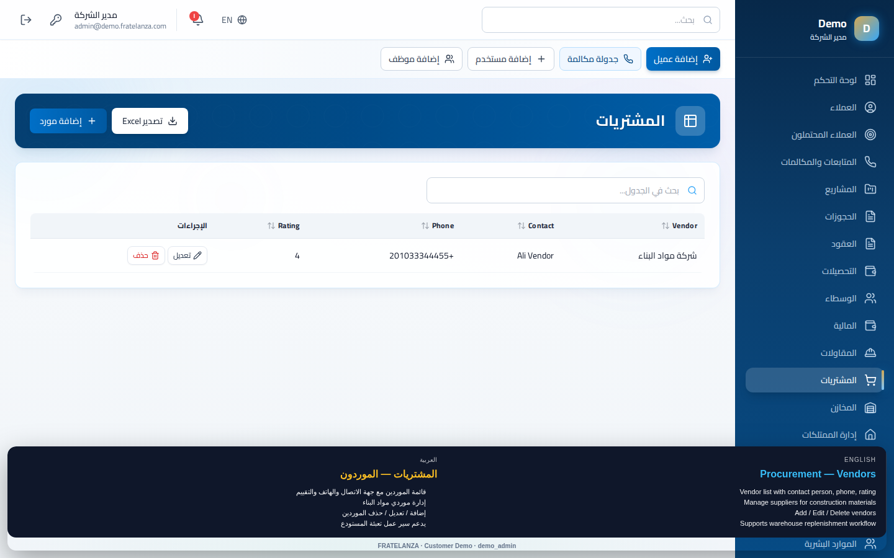

| | |
|---|---|
| **Route** | `/procurement` |
| **Screenshot** | `14-procurement.png` |

### English — Features & details

- Vendor list with contact person, phone, rating
- Manage suppliers for construction materials
- Add / Edit / Delete vendors
- Supports warehouse replenishment workflow

### العربية — الميزات والتفاصيل

- قائمة الموردين مع جهة الاتصال والهاتف والتقييم
- إدارة موردي مواد البناء
- إضافة / تعديل / حذف الموردين
- يدعم سير عمل تعبئة المستودع

---

## 16. Warehouse — Inventory (Stock) / المستودع — المخزون

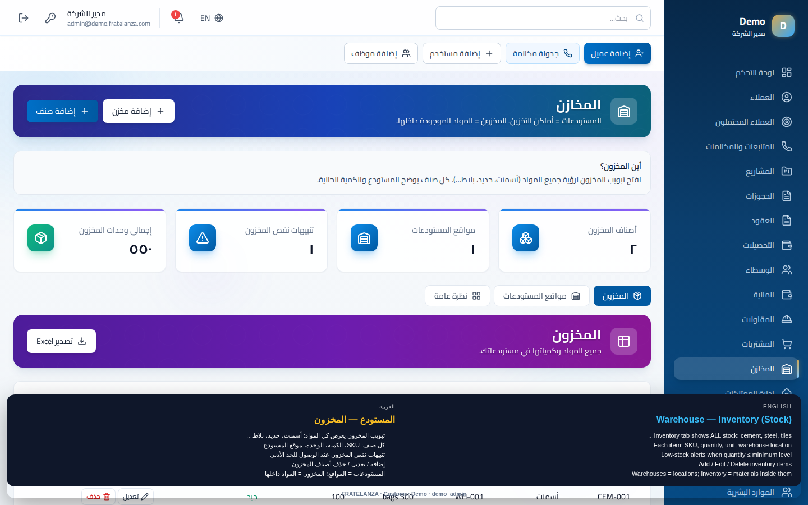

| | |
|---|---|
| **Route** | `/warehouse` |
| **Screenshot** | `15-warehouse-inventory.png` |

### English — Features & details

- Inventory tab shows ALL stock: cement, steel, tiles…
- Each item: SKU, quantity, unit, warehouse location
- Low-stock alerts when quantity ≤ minimum level
- Add / Edit / Delete inventory items
- Warehouses = locations; Inventory = materials inside them

### العربية — الميزات والتفاصيل

- تبويب المخزون يعرض كل المواد: أسمنت، حديد، بلاط…
- كل صنف: SKU، الكمية، الوحدة، موقع المستودع
- تنبيهات نقص المخزون عند الوصول للحد الأدنى
- إضافة / تعديل / حذف أصناف المخزون
- المستودعات = المواقع؛ المخزون = المواد داخلها

---

## 17. Warehouse — Storage Locations / المستودع — مواقع التخزين

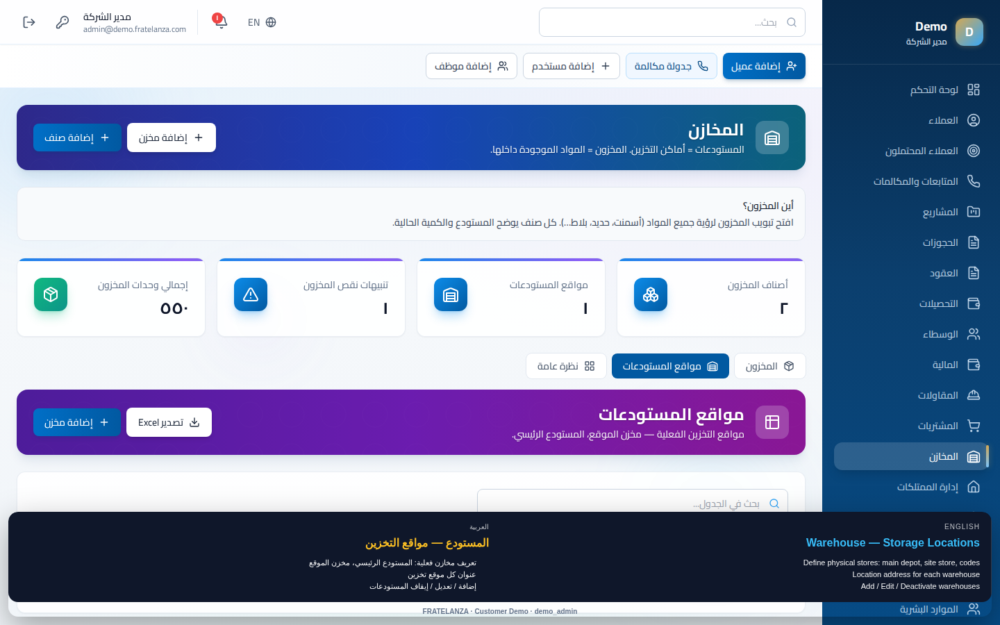

| | |
|---|---|
| **Route** | `/warehouse` |
| **Screenshot** | `16-warehouse-locations.png` |

### English — Features & details

- Define physical stores: main depot, site store, codes
- Location address for each warehouse
- Add / Edit / Deactivate warehouses

### العربية — الميزات والتفاصيل

- تعريف مخازن فعلية: المستودع الرئيسي، مخزن الموقع
- عنوان كل موقع تخزين
- إضافة / تعديل / إيقاف المستودعات

---

## 18. Property Management — After Handover / إدارة الممتلكات — بعد التسليم

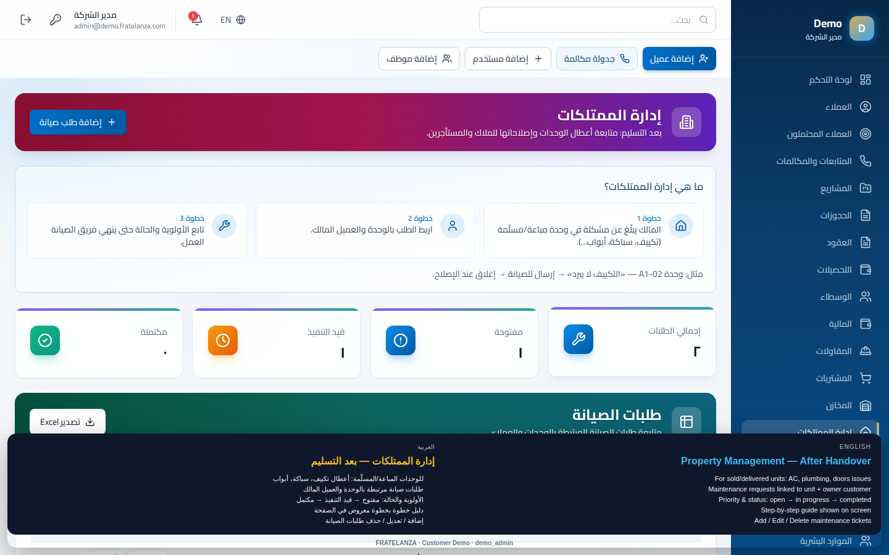

| | |
|---|---|
| **Route** | `/property` |
| **Screenshot** | `17-property-management.png` |

### English — Features & details

- For sold/delivered units: AC, plumbing, doors issues
- Maintenance requests linked to unit + owner customer
- Priority & status: open → in progress → completed
- Step-by-step guide shown on screen
- Add / Edit / Delete maintenance tickets

### العربية — الميزات والتفاصيل

- للوحدات المباعة/المسلّمة: أعطال تكييف، سباكة، أبواب
- طلبات صيانة مرتبطة بالوحدة والعميل المالك
- الأولوية والحالة: مفتوح → قيد التنفيذ → مكتمل
- دليل خطوة بخطوة معروض في الصفحة
- إضافة / تعديل / حذف طلبات الصيانة

---

## 19. Finance — P&L, Cash, Accounts / المالية — الأرباح والنقد والحسابات

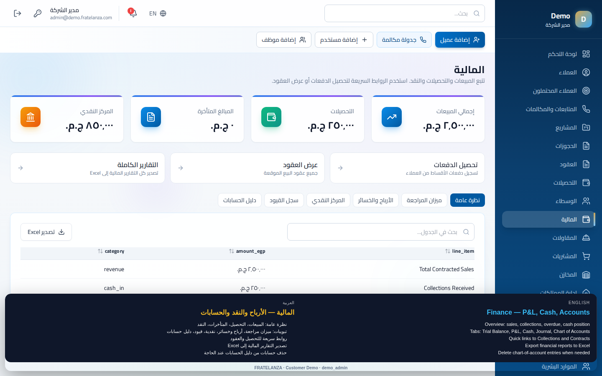

| | |
|---|---|
| **Route** | `/finance` |
| **Screenshot** | `18-finance.png` |

### English — Features & details

- Overview: sales, collections, overdue, cash position
- Tabs: Trial Balance, P&L, Cash, Journal, Chart of Accounts
- Quick links to Collections and Contracts
- Export financial reports to Excel
- Delete chart-of-account entries when needed

### العربية — الميزات والتفاصيل

- نظرة عامة: المبيعات، التحصيل، المتأخرات، النقد
- تبويبات: ميزان مراجعة، أرباح وخسائر، نقدية، قيود، دليل حسابات
- روابط سريعة للتحصيل والعقود
- تصدير التقارير المالية إلى Excel
- حذف حسابات من دليل الحسابات عند الحاجة

---

## 20. HR — Employees & Payroll / الموارد البشرية — الموظفون والرواتب

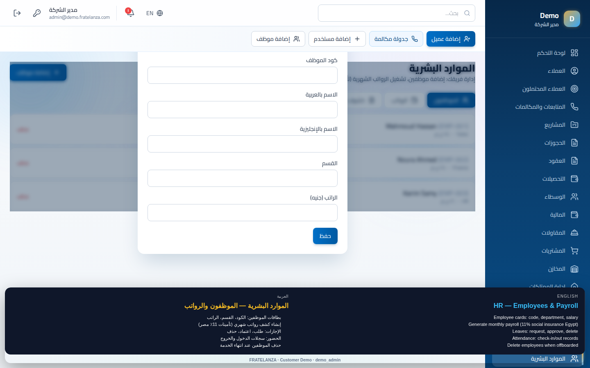

| | |
|---|---|
| **Route** | `/hr` |
| **Screenshot** | `19-hr-employees.png` |

### English — Features & details

- Employee cards: code, department, salary
- Generate monthly payroll (11% social insurance Egypt)
- Leaves: request, approve, delete
- Attendance: check-in/out records
- Delete employees when offboarded

### العربية — الميزات والتفاصيل

- بطاقات الموظفين: الكود، القسم، الراتب
- إنشاء كشف رواتب شهري (تأمينات 11٪ مصر)
- الإجازات: طلب، اعتماد، حذف
- الحضور: سجلات الدخول والخروج
- حذف الموظفين عند انتهاء الخدمة

---

## 21. HR — Payslips / الموارد البشرية — كشوف الرواتب

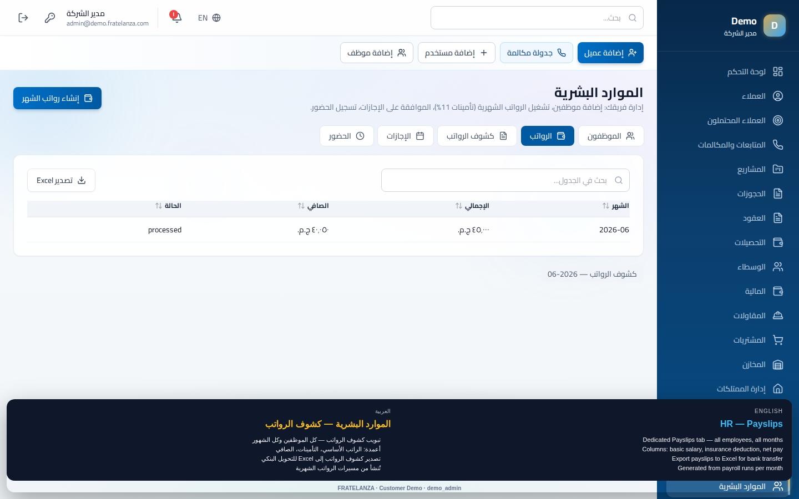

| | |
|---|---|
| **Route** | `/hr` |
| **Screenshot** | `20-hr-payslips.png` |

### English — Features & details

- Dedicated Payslips tab — all employees, all months
- Columns: basic salary, insurance deduction, net pay
- Export payslips to Excel for bank transfer
- Generated from payroll runs per month

### العربية — الميزات والتفاصيل

- تبويب كشوف الرواتب — كل الموظفين وكل الشهور
- أعمدة: الراتب الأساسي، التأمينات، الصافي
- تصدير كشوف الرواتب إلى Excel للتحويل البنكي
- تُنشأ من مسيرات الرواتب الشهرية

---

## 22. Reports — Analytics Center / التقارير — مركز التحليلات

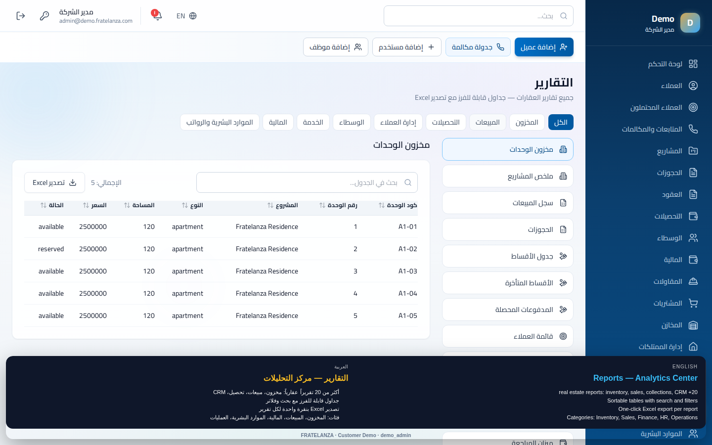

| | |
|---|---|
| **Route** | `/reports` |
| **Screenshot** | `21-reports.png` |

### English — Features & details

- 20+ real estate reports: inventory, sales, collections, CRM
- Sortable tables with search and filters
- One-click Excel export per report
- Categories: Inventory, Sales, Finance, HR, Operations

### العربية — الميزات والتفاصيل

- أكثر من 20 تقريراً عقارياً: مخزون، مبيعات، تحصيل، CRM
- جداول قابلة للفرز مع بحث وفلاتر
- تصدير Excel بنقرة واحدة لكل تقرير
- فئات: المخزون، المبيعات، المالية، الموارد البشرية، العمليات

---

## 23. AI Assistant — Business Insights / المساعد الذكي — رؤى الأعمال

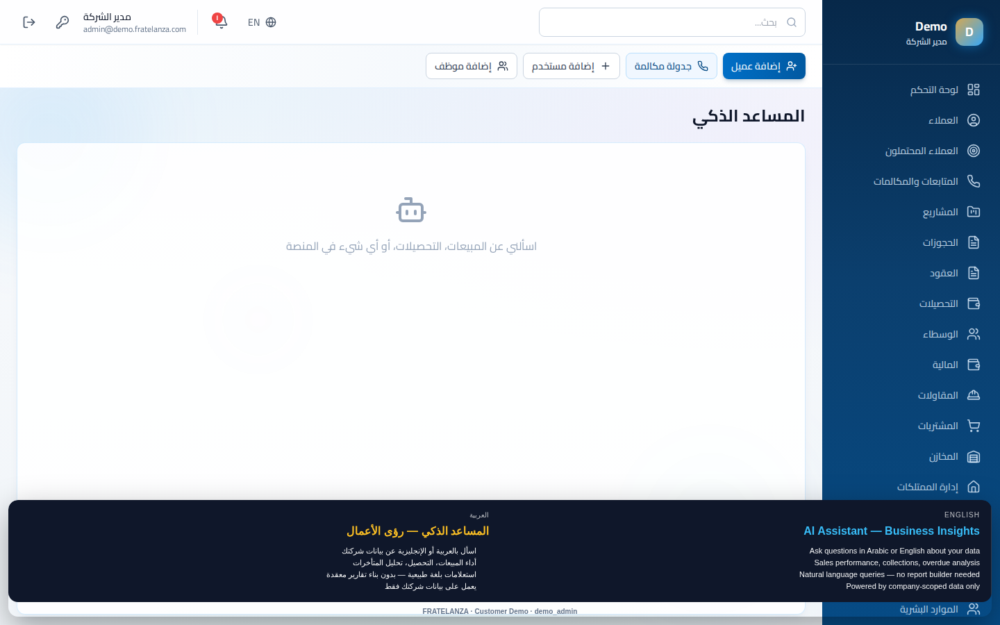

| | |
|---|---|
| **Route** | `/ai-assistant` |
| **Screenshot** | `22-ai-assistant.png` |

### English — Features & details

- Ask questions in Arabic or English about your data
- Sales performance, collections, overdue analysis
- Natural language queries — no report builder needed
- Powered by company-scoped data only

### العربية — الميزات والتفاصيل

- اسأل بالعربية أو الإنجليزية عن بيانات شركتك
- أداء المبيعات، التحصيل، تحليل المتأخرات
- استعلامات بلغة طبيعية — بدون بناء تقارير معقدة
- يعمل على بيانات شركتك فقط

---

## 24. Customer Service — Support Tickets / خدمة العملاء — تذاكر الدعم

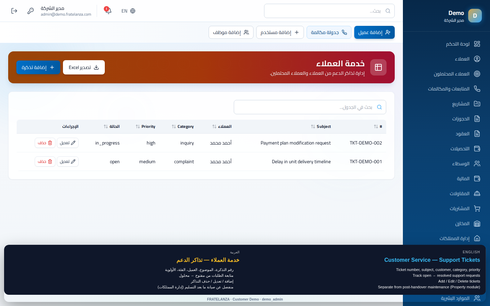

| | |
|---|---|
| **Route** | `/customer-service` |
| **Screenshot** | `23-customer-service.png` |

### English — Features & details

- Ticket number, subject, customer, category, priority
- Track open → resolved support requests
- Add / Edit / Delete tickets
- Separate from post-handover maintenance (Property module)

### العربية — الميزات والتفاصيل

- رقم التذكرة، الموضوع، العميل، الفئة، الأولوية
- متابعة الطلبات من مفتوح → محلول
- إضافة / تعديل / حذف التذاكر
- منفصل عن صيانة ما بعد التسليم (إدارة الممتلكات)

---

## 25. Team Users — Roles & Access / مستخدمي الفريق — الأدوار والصلاحيات

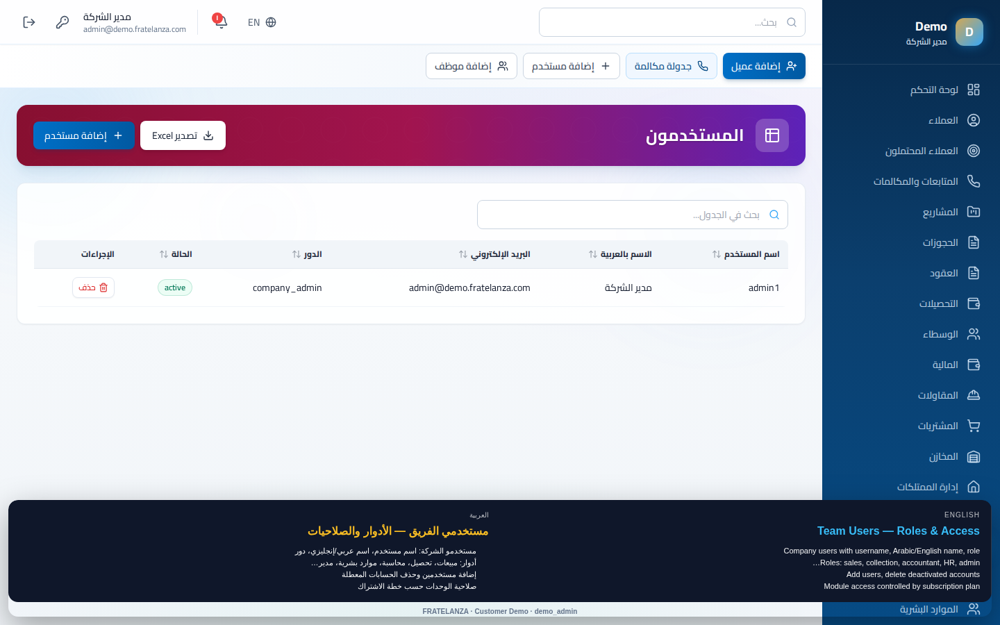

| | |
|---|---|
| **Route** | `/users` |
| **Screenshot** | `24-team-users.png` |

### English — Features & details

- Company users with username, Arabic/English name, role
- Roles: sales, collection, accountant, HR, admin…
- Add users, delete deactivated accounts
- Module access controlled by subscription plan

### العربية — الميزات والتفاصيل

- مستخدمو الشركة: اسم مستخدم، اسم عربي/إنجليزي، دور
- أدوار: مبيعات، تحصيل، محاسبة، موارد بشرية، مدير…
- إضافة مستخدمين وحذف الحسابات المعطلة
- صلاحية الوحدات حسب خطة الاشتراك

---

## 26. Branding — Your Company Identity / الهوية البصرية — هوية شركتك

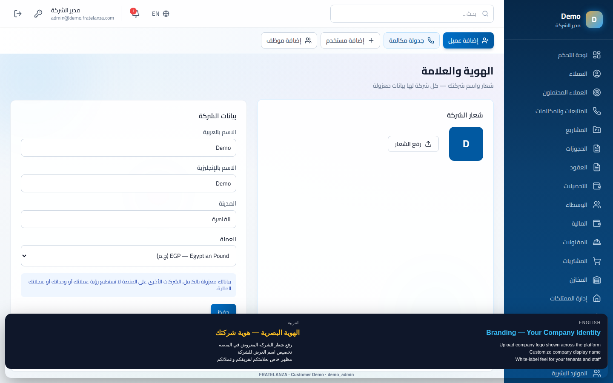

| | |
|---|---|
| **Route** | `/branding` |
| **Screenshot** | `25-branding.png` |

### English — Features & details

- Upload company logo shown across the platform
- Customize company display name
- White-label feel for your tenants and staff

### العربية — الميزات والتفاصيل

- رفع شعار الشركة المعروض في المنصة
- تخصيص اسم العرض للشركة
- مظهر خاص بعلامتكم لفريقكم وعملائكم

---
