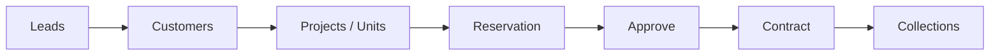

# Fratelanza Real Estate Platform
# Demo User Manual (English)

**Version:** Demo 1.0  
**Audience:** Prospective customers evaluating the platform  
**Company in demo:** Fratelanza Real Estate Development (شركة فراتيلانزا للتطوير العقاري)

---

## 1. Welcome

Fratelanza is an integrated platform for real estate developers. It connects the full business cycle in one place:

- **Sales:** leads → customers → reservations → contracts  
- **Collections:** installments and payments  
- **Operations:** projects, construction, procurement, warehouse  
- **Support:** follow-ups, customer service, HR, finance, reports  

This manual walks you through the **demo environment** step by step so you can explore every major feature without training.

> **Arabic manual:** [DEMO-USER-MANUAL-AR.md](./DEMO-USER-MANUAL-AR.md)

---

## 2. Access the demo

| Item | Value |
|------|--------|
| **Login page** | Open your demo URL (e.g. `http://your-server:9000/login`) |
| **Email** | `admin@demo.fratelanza.com` |
| **Password** | `Demo123456` |
| **Role** | Company Administrator (full access to company modules) |

### First login

1. Enter email and password, then click **Login**.
2. You land on the **Dashboard** with KPI cards (sales, collections, available units, active leads).
3. Use the **language switcher** (top bar) to toggle **Arabic** or **English**. The interface and number formats update automatically.

### If tables look empty

1. Go to **Dashboard**.
2. Click **Load Demo Data** (top right).
3. Wait for the confirmation message, then open any module from the sidebar.

---

## 3. Screen layout

```
┌─────────────────────────────────────────────────────────────┐
│  Logo   Global Search   Language   Notifications   Profile  │
├──────────────┬──────────────────────────────────────────────┤
│              │                                              │
│   SIDEBAR    │              MAIN CONTENT AREA               │
│   (modules)  │   Page title + Add / Export buttons          │
│              │   Tables, charts, forms, kanban boards       │
│              │                                              │
└──────────────┴──────────────────────────────────────────────┘
```

| Area | What it does |
|------|----------------|
| **Sidebar** | Navigate between modules (Dashboard, Customers, Leads, Projects, etc.) |
| **Global search** | Find customers, leads, contracts, units, projects, brokers |
| **Quick actions** | Shortcuts to add client, schedule call, add user |
| **Page header** | Module title + primary actions (Add, Export Excel) |
| **Table rows** | **Edit** and **Delete** on most lists; workflow icons where applicable |

### Common buttons

| Button | Meaning |
|--------|---------|
| **Add** (+) | Create a new record |
| **Edit** | Change an existing record |
| **Delete** | Remove or deactivate (confirmation required) |
| **Export Excel** | Download the current table |

---

## 4. Recommended demo tour (30 minutes)

Follow this order to see how modules **connect to each other**:



| Step | Module | What to do |
|------|--------|------------|
| 1 | **Leads** | Open Kanban view; move a lead between stages; add a new lead |
| 2 | **Customers** | View client list; add a client (optionally create lead automatically) |
| 3 | **Projects** | Open **Units Board**; click an **available** (green) unit |
| 4 | **Reservations** | Create or review reservation; click **Approve** (checkmark) |
| 5 | **Contracts** | Convert approved reservation to contract, or add contract directly |
| 6 | **Collections** | Open installments; click **Record Payment** on a due/partial row |
| 7 | **Finance** | See cash position and profit/loss linked to collections |
| 8 | **Follow-ups** | Schedule a call from a lead; mark complete with outcome |
| 9 | **Reports** | Export sales, inventory, or finance reports to Excel |

---

## 5. Module guide

### 5.1 Dashboard

**Path:** Sidebar → Dashboard

- **KPI cards:** Total sales, collections, available units, active leads  
- **Action center:** Overdue amounts, follow-ups, HR, finance shortcuts  
- **Charts:** Sales trend and lead pipeline  
- **Load Demo Data:** Fills sample brokers, warehouse, reservations, construction phases  

---

### 5.2 Customers (العملاء)

**Path:** Sidebar → Customers

| Action | Steps |
|--------|--------|
| **Add client** | Click **Add Client** → fill Arabic/English name, mobile, city → Save |
| **Import** | **Bulk Import** → upload Excel template |
| **Schedule call** | Row action → opens follow-up reminder |
| **Search** | Use search box to filter by name or mobile |

**Demo data:** Ahmed Mohamed (أحمد محمد) — `+201012345678`

---

### 5.3 Leads (العملاء المحتملون)

**Path:** Sidebar → Leads

**Kanban view** (default): columns = pipeline stages (New → Contacted → … → Contract Signed / Lost)

| Action | Steps |
|--------|--------|
| **Add lead** | **Add Lead** → name, mobile, source, project |
| **Move stage** | Use dropdown on card, or drag mentally via stage list |
| **Edit lead** | Pencil icon on card or list row |
| **Schedule call** | **Schedule Call** on card → sets reminder in Follow-ups |
| **Delete** | Trash icon (list view or via edit flow) |

**List view:** Toggle **List** for a sortable table with Edit/Delete.

**Demo data:** Sara Ali — Facebook lead, stage: Interested

---

### 5.4 Follow-ups (المتابعات)

**Path:** Sidebar → Follow-ups

- **Today & overdue queue** on the left  
- **Detail panel** on the right for selected reminder  
- **Schedule Call** → link to customer or lead  
- **Complete Call** → record outcome (interested, not interested, callback, etc.)  
- Quick links to **WhatsApp** and **phone** on each row  

Moving a lead to a new stage can **auto-create** follow-up reminders.

---

### 5.5 Projects & Units (المشاريع)

**Path:** Sidebar → Projects

#### Units Board (لوحة الوحدات)

Units are grouped by status:

| Color | Status | Meaning |
|-------|--------|---------|
| Green | Available | Ready to sell |
| Amber | Reserved | Held by reservation |
| Blue | Contracted | Under active contract |

| Action | Steps |
|--------|--------|
| **Reserve unit** | Click an **available** unit card → reservation form opens with unit pre-selected |
| **Add project** | **Add Project** → name (AR/EN), code, city |
| **Add unit** | **Add Unit** → select floor, code, type, area, price |
| **List view** | Toggle **Projects List** → Edit/Delete projects |

**Demo project:** Fratelanza Residence (FR-001) — units A1-01 … A1-05

---

### 5.6 Reservations (الحجوزات)

**Path:** Sidebar → Reservations

| Action | Steps |
|--------|--------|
| **Add** | **Add Reservation** → customer + unit + deposit + dates |
| **Approve** | Checkmark icon when status = *Pending Approval* |
| **Convert to contract** | Document icon when status = *Approved* |
| **Edit / Delete** | Row actions |

**Business rule:** Creating a reservation **locks** the unit so it cannot be sold twice.

**Demo data:** RES-DEMO-001 — Unit A1-02, pending approval

---

### 5.7 Contracts (العقود)

**Path:** Sidebar → Contracts

| Action | Steps |
|--------|--------|
| **Add contract** | Customer + unit + total price + date |
| **From reservation** | Approve reservation → **Convert to Contract** |
| **View collections** | Credit-card icon on row → jump to Collections |
| **Edit / Delete** | Row actions |

**Auto behavior:** New contracts generate a **payment plan** and **installments** in Collections.

**Demo data:** CNT-DEMO-001 — Ahmed Mohamed, Unit A1-01, 2,500,000 EGP

---

### 5.8 Collections (التحصيل)

**Path:** Sidebar → Collections

Shows installments with:

- Contract number, customer name, unit code  
- Due date, amount, paid, remaining, status  

| Action | Steps |
|--------|--------|
| **Record payment** | Credit-card icon on unpaid/partial row → amount, date, method |
| **Export** | **Export Excel** for finance team |

Statuses: *Due*, *Partial*, *Paid*, *Overdue*

---

### 5.9 Brokers (الوسطاء)

**Path:** Sidebar → Brokers

| Action | Steps |
|--------|--------|
| **Add broker** | Name, mobile, commission % |
| **Edit / Delete** | Row actions |

**Demo data:** Mohamed Broker — 3% commission

---

### 5.10 Finance (المالية)

**Path:** Sidebar → Finance

Tabs: Overview, Trial Balance, Profit & Loss, Cash Position, Journal, Chart of Accounts

- Overview links to **Collections** and **Contracts**  
- Export reports to Excel  
- Demo includes sample journal entry for down payment received  

---

### 5.11 Construction (المقاولات)

**Path:** Sidebar → Construction

| Action | Steps |
|--------|--------|
| **Add phase** | Link to project, name, progress %, dates |
| **Edit / Delete** | Row actions |

**Demo data:** Concrete Structure (65%), Finishing (20%)

---

### 5.12 Procurement (المشتريات)

**Path:** Sidebar → Procurement

Manage **vendors** (suppliers): add, edit, deactivate.

**Demo data:** Building Materials Co.

---

### 5.13 Warehouse (المخازن)

**Path:** Sidebar → Warehouse

Two tabs:

| Tab | Content |
|-----|---------|
| **Warehouse** | Storage locations (code, name, location) |
| **Inventory Items** | SKUs, quantities, low-stock alerts |

**Demo data:** Main Warehouse (WH-001), cement and steel items

---

### 5.14 Human Resources (الموارد البشرية)

**Path:** Sidebar → HR

Tabs: Employees, Payroll, Leaves, Attendance

- Add employees, request/approve leave, record attendance  
- **Generate Payroll** for current month  

**Demo data:** 3 employees (Sales, Finance, HR)

---

### 5.15 Property Management (إدارة الممتلكات)

**Path:** Sidebar → Property

Maintenance requests linked to units (view list; demo may be empty until you add requests).

---

### 5.16 Customer Service (خدمة العملاء)

**Path:** Sidebar → Customer Service

Support **tickets** with subject, category, priority, status.

---

### 5.17 Users (المستخدمون)

**Path:** Sidebar → Users

Add company users with role (admin, sales, finance, etc.).

---

### 5.18 Reports (التقارير)

**Path:** Sidebar → Reports

Sortable tables by category: inventory, sales, finance, HR, etc.  
**Export Excel** on each report.

---

### 5.19 Branding (الهوية)

**Path:** Sidebar → Branding

Upload company logo and set brand colors for the tenant.

---

### 5.20 AI Assistant (المساعد الذكي)

**Path:** Sidebar → AI Assistant

Chat interface for platform help and business questions (demo).

---

## 6. End-to-end sales scenario (hands-on)

Use this script when presenting to a customer:

### Scenario: New buyer reserves apartment A1-03

1. **Leads** → **Add Lead**  
   - Name: `Omar Hassan`  
   - Mobile: `+201011122233`  
   - Source: Walk-in  
   - Project: Fratelanza Residence  

2. **Customers** → **Add Client** (same person)  
   - Check **Create lead automatically** if you skipped step 1  

3. **Projects** → **Units Board**  
   - Find unit **A1-03** (green / available)  
   - Click the card  

4. In the reservation form:  
   - Customer: Omar Hassan / Ahmed (demo)  
   - Deposit: `100,000`  
   - Expiry: 14 days from today  
   - **Save**  

5. **Reservations** → find new row → click **Approve** (✓)  

6. Click **Convert to Contract** (document icon)  
   - Total price: `2,500,000`  
   - **Save**  

7. **Collections** → find new installments → **Record Payment** on first installment  

8. **Dashboard** → confirm KPIs updated  

---

## 7. Global search

Click the search box in the header and type:

- Customer name or mobile  
- Lead name  
- Contract number  
- Unit code (e.g. `A1-02`)  
- Project name  

Results link directly to the relevant module.

---

## 8. Demo sample data reference

| Module | Sample records |
|--------|----------------|
| Project | Fratelanza Residence (FR-001), 5 units |
| Customer | Ahmed Mohamed |
| Lead | Sara Ali (Facebook, Interested) |
| Reservation | RES-DEMO-001 on A1-02 |
| Contract | CNT-DEMO-001 on A1-01 |
| Installment | Partial payment on contract CNT-DEMO-001 |
| Broker | Mohamed Broker |
| Warehouse | WH-001 + cement & steel |
| Vendor | Building Materials Co. |
| Construction | 2 phases with progress % |
| HR | 3 employees |

---

## 9. Tips for evaluators

1. **Start with Load Demo Data** if anything looks empty.  
2. **Use Arabic** to see RTL layout — important for Egyptian/GCC markets.  
3. **Follow the pipeline** Leads → Units → Reservation → Contract → Collections — this is the core value.  
4. **Export Excel** on any table to show reporting capability.  
5. **Follow-ups + Leads** show CRM discipline, not just data entry.  

---

## 10. Frequently asked questions

**Q: Can I break the demo?**  
A: You can add and delete test data freely. Use **Load Demo Data** to restore samples.

**Q: Why is a unit not available for reservation?**  
A: It may already be reserved or contracted. Only **green (available)** units can be reserved.

**Q: Password not working?**  
A: Use exactly `Demo123456` for the demo company admin. Super admin is separate (`admin@fratelanza.com`).

**Q: Module missing from sidebar?**  
A: Subscription plan controls enabled modules. Demo company uses the Professional plan with all modules.

**Q: How do I get a production account?**  
A: Contact Fratelanza sales — Super Admin creates your company, plan, and admin user.

---

## 11. Support & next steps

| Need | Contact |
|------|---------|
| Live demo walkthrough | Your Fratelanza account manager |
| Technical API docs | `/docs` on your server (Swagger) |
| Deployment guide | [16-hostinger-deployment.md](./16-hostinger-deployment.md) |

---

*© Fratelanza Real Estate Platform — Demo User Manual*
