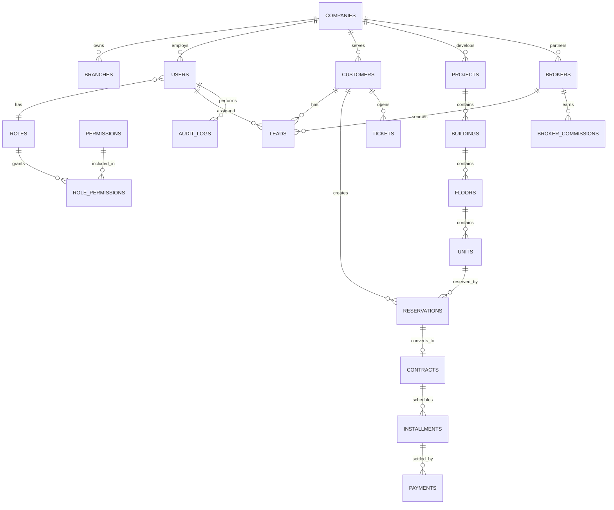

# FRATELANZA REAL ESTATE PLATFORM - Enterprise Blueprint

## 1. Full Business Analysis

### Vision

FRATELANZA REAL ESTATE PLATFORM is a cloud-based SaaS platform for real estate developers, brokers, property operators, construction teams, finance departments, HR teams, and customers across Egypt, Saudi Arabia, UAE, Qatar, Kuwait, Bahrain, Oman, and international markets.

The platform owner operates as Super Admin and can create tenant companies, control subscriptions, monitor all records, enforce permissions, configure languages, and export or back up any data.

### Business Objectives

- Centralize real estate development operations in one SaaS platform.
- Support multiple developer companies without data leakage.
- Increase sales conversion using CRM, lead scoring, automated follow-ups, and AI insights.
- Improve cash collection through installment tracking, aging reports, forecasting, and notifications.
- Reduce operational friction between sales, finance, construction, procurement, property management, brokers, and customer service.
- Provide Arabic RTL and English LTR experiences for users, contracts, statements, and reports.
- Enable executive decisions through real-time business intelligence dashboards.

### Key Stakeholders

- Platform Owner / Super Admin
- Developer Company Owners and Company Admins
- CEOs and Managing Directors
- Sales Directors, Managers, and Agents
- Customer Service and Collection Teams
- Finance and Accounting Teams
- Project Managers, Engineers, Procurement, Warehouse, HR
- Brokers and External Partners
- End Customers and Unit Owners

### Success Metrics

- Lead-to-reservation conversion rate
- Reservation-to-contract conversion rate
- Collection on-time percentage
- Overdue installment amount and aging distribution
- Unit inventory absorption rate
- Broker performance and commission cycle time
- Ticket SLA compliance
- Project progress variance and cost variance
- Tenant company retention and subscription growth

## 2. Complete SRS

### Scope

The system provides modules for:

1. Super Admin control panel
2. Company Admin control panel
3. RBAC and authentication
4. Customer management
5. CRM and sales pipeline
6. Real estate inventory hierarchy
7. Reservation management
8. Contract management
9. Installments and collections
10. Broker portal
11. Customer portal
12. Property management
13. Construction management
14. Procurement and warehouse
15. Finance and accounting
16. HR system
17. Customer service
18. AI features
19. Business intelligence
20. Notifications
21. Document management
22. Search and exports

### Functional Requirements

#### Super Admin

- Create, update, suspend, and activate companies.
- Create branches, projects, and users across all companies.
- Manage global roles, permissions, subscription plans, storage limits, languages, themes, system settings, backups, restore operations, and exports.
- View all dashboards and all records across tenants.
- Monitor audit logs and activity logs.

#### Company Admin

- Manage company users, customers, projects, teams, brokers, and reports.
- Access only company-owned records.
- Configure company-level branding and operational settings.

#### CRM

- Capture leads from Facebook, Instagram, TikTok, Google Ads, website, referrals, brokers, call center, and walk-ins.
- Assign leads to sales teams.
- Track pipeline stages: New, Contacted, Interested, Site Visit, Negotiation, Reservation, Contract Signed, Lost.
- Track calls, meetings, visits, notes, reminders, and score changes.
- Support AI lead qualification.

#### Real Estate Inventory

- Model companies, projects, buildings/towers, floors, and units.
- Store unit area, amenities, attachments, pricing, fees, delivery date, and images.
- Enforce statuses: Available, Reserved, Contracted, Sold, Delivered, Blocked.
- Prevent double reservation or sale of unavailable units.

#### Reservations and Contracts

- Create reservation with customer, unit, deposit, reservation date, and expiry date.
- Apply workflow: Draft, Pending Approval, Approved, Expired, Cancelled, Converted To Contract.
- Auto-lock reserved units and expire old reservations.
- Generate Arabic and English contracts with version history and approval workflow.
- Integrate electronic signature providers through an adapter.

#### Installments and Collections

- Configure monthly, quarterly, semi-annual, annual, and custom payment plans.
- Generate schedules automatically from contract terms.
- Track due, paid, remaining, upcoming, overdue, and paid statuses.
- Produce customer statements and collection dashboards.
- Trigger email, SMS, WhatsApp, push, and in-app notifications.

#### Finance and Accounting

- Maintain chart of accounts, journal entries, receivables, payables, bank accounts, reconciliations, cost centers, budgets, cash flow, balance sheet, profit and loss, aging reports, and project profitability.
- Link contracts, payments, commissions, procurement, and construction costs to accounting entries.

#### Construction, Procurement, Warehouse, HR, Service

- Track project phases, activities, tasks, milestones, progress, cost, contractors, delays, and risks.
- Support vendors, RFQ, purchase orders, approvals, deliveries, consumption, vendor evaluation.
- Track warehouses, stock, transfers, movements, audits, low stock alerts, barcode, and QR code.
- Manage employees, attendance, payroll, recruitment, leaves, performance, training, disciplinary actions, and org chart.
- Handle tickets, complaints, inquiries, maintenance requests, SLA, escalation, and knowledge base.

### Non-Functional Requirements

- Responsive web application for desktop, tablet, and mobile.
- Arabic RTL and English LTR with dynamic switching.
- PostgreSQL as system of record.
- Redis for cache, sessions, and background job coordination.
- JWT authentication and RBAC authorization.
- Encryption at rest where storage provider supports it and TLS in transit.
- Tenant isolation by `company_id`.
- Super Admin override audited for sensitive access.
- Structured logging and audit trail.
- Docker-based deployment on Linux VPS behind Nginx.
- API-first backend with OpenAPI documentation.
- Export support for Excel, PDF, CSV, and print layouts.

## 3. Database Design

### Multi-Tenant Strategy

The platform uses shared database, shared schema, tenant discriminator columns:

- `companies.id` is the tenant root.
- Business records include nullable or required `company_id`.
- Super Admin users can have `company_id = null`.
- Tenant-level API dependencies automatically scope queries by current user's company unless the user has `platform:all`.
- All sensitive cross-tenant reads are logged in `audit_logs`.

This strategy keeps operations simple for SaaS launch and can later evolve to schema-per-tenant for premium enterprise customers.

### Core Tables

- `companies`, `branches`, `subscription_plans`
- `users`, `roles`, `permissions`, `role_permissions`
- `customers`, `customer_documents`, `customer_timeline_events`
- `projects`, `buildings`, `floors`, `units`
- `leads`, `lead_activities`, `lead_assignments`
- `reservations`, `contracts`, `contract_versions`
- `payment_plans`, `installments`, `payments`
- `brokers`, `broker_commissions`
- `tickets`, `maintenance_requests`
- `notifications`, `audit_logs`, `documents`

## 4. ERD



## 5. API Documentation

OpenAPI is available from FastAPI at `/docs` and `/openapi.json`.

### API Versioning

All public API endpoints are mounted under `/api/v1`.

### Core Endpoint Groups

| Group | Endpoint | Purpose |
| --- | --- | --- |
| Health | `GET /health` | Service status |
| Auth | `POST /api/v1/auth/login` | JWT login |
| Auth | `GET /api/v1/auth/me` | Current user profile |
| Companies | `GET /api/v1/companies` | Super Admin company list |
| Companies | `POST /api/v1/companies` | Create tenant company |
| Users | `GET /api/v1/users` | Tenant-scoped users |
| Customers | `GET /api/v1/customers` | Search customers |
| Customers | `POST /api/v1/customers` | Create customer |
| Projects | `GET /api/v1/projects` | Projects and hierarchy summary |
| Units | `GET /api/v1/units` | Unit inventory search |
| Reservations | `POST /api/v1/reservations` | Reserve an available unit |
| Contracts | `POST /api/v1/contracts` | Convert reservation to contract |
| Collections | `GET /api/v1/installments` | Installment ledger |
| BI | `GET /api/v1/dashboard/executive` | Executive KPIs |

### API Principles

- JWT bearer authentication.
- Permission dependency per route.
- Company scoping by current user.
- Request and response models use Pydantic.
- Errors follow RFC 7807-style structure where feasible.

## 6. Folder Structure

```text
backend/
  app/
    api/v1/
    core/
    db/
    scripts/
    main.py
    models.py
    schemas.py
  tests/
frontend/
  src/
    components/
    i18n/
    layouts/
    pages/
    services/
    types/
docs/
infrastructure/
```

## 7. Frontend Architecture

- React + TypeScript + Vite.
- Tailwind CSS utility-first styling.
- Shadcn-compatible component structure.
- `AppShell` controls navigation, language direction, theme-ready layout, and responsive behavior.
- `i18n` dictionary provides Arabic and English translations.
- Dashboard pages are modular and can later be connected to live APIs through service functions.
- Components are designed for RTL-first Arabic UX with LTR English support.

## 8. Backend Architecture

- FastAPI application factory in `app/main.py`.
- SQLAlchemy ORM models in `app/models.py`.
- Pydantic schemas in `app/schemas.py`.
- Settings managed through environment variables.
- JWT and password hashing in `app/core/security.py`.
- RBAC constants and permission matrix in `app/core/rbac.py`.
- API routers separated by business domain.
- Database sessions controlled by dependency injection.
- Tenant isolation handled in API dependencies and query filters.

## 9. Security Design

### Authentication

- JWT access tokens signed with configurable secret.
- Argon2 password hashing.
- 2FA-ready fields in user model.
- Password reset flow planned through secure one-time tokens.

### Authorization

- Role-based access control with permissions such as:
  - `platform:all`
  - `companies:manage`
  - `users:manage`
  - `customers:read`
  - `customers:write`
  - `units:manage`
  - `reservations:approve`
  - `contracts:approve`
  - `finance:read`
  - `finance:write`
  - `reports:read`

### Tenant Isolation

- Non-Super Admin users are constrained by `company_id`.
- Super Admin global access is explicit and audited.

### Operational Security

- CORS allow-list.
- Nginx TLS termination.
- Secrets through `.env` or external secret manager.
- Audit logs for authentication, exports, permission updates, cross-tenant reads, financial changes, and backup/restore.
- IP restrictions can be enforced at Nginx and application middleware levels.

## 10. UI Design System

### Brand Direction

- Name: FRATELANZA REAL ESTATE PLATFORM
- Tone: premium, enterprise, modern, bilingual, high-trust.
- Primary color: deep navy `#0f172a`
- Accent color: emerald `#10b981`
- Secondary accent: gold `#d4af37`
- Background: slate and white gradients

### Components

- App shell with collapsible side navigation.
- KPI cards.
- Data tables with filters and export actions.
- Kanban CRM pipeline.
- Unit inventory grid with status chips.
- Timeline component for customer profiles.
- Approval workflow panels.
- Interactive chart containers.
- Contract preview and print templates.

### RTL/LTR

- Arabic defaults to `dir="rtl"`.
- English defaults to `dir="ltr"`.
- Icons and spacing use logical CSS where possible.

## 11. User Journeys

### Super Admin Creates a Company

1. Login as Super Admin.
2. Open Companies.
3. Create company with plan, region, storage limits, and admin user.
4. System provisions default roles and permissions.
5. Company Admin receives activation email.

### Sales Agent Converts Lead to Reservation

1. Receives assigned lead.
2. Completes calls and site visit.
3. Selects available unit.
4. Creates reservation and deposit.
5. Reservation enters approval workflow.
6. Unit status becomes Reserved after approval.

### Finance Collects Installment

1. Opens collection dashboard.
2. Filters overdue installments.
3. Contacts customer through WhatsApp/SMS/email.
4. Records payment.
5. Installment becomes Paid or partially paid.
6. Accounting entry is generated.

### Customer Uses Portal

1. Logs in.
2. Views reservations, contracts, installments, and payments.
3. Downloads documents.
4. Opens request or complaint.
5. Tracks SLA status.

## 12. Dashboard Designs

### Executive Dashboard

- Total sales value
- Net collected amount
- Overdue balance
- Available vs sold units
- Reservation conversion rate
- Top projects by sales
- Forecasted collections
- Ticket SLA health

### Sales Dashboard

- Leads by source
- Pipeline stage distribution
- Sales agent leaderboard
- Site visits and follow-ups
- Lost reasons

### Finance Dashboard

- Receivables aging
- Cash flow
- Bank balances
- P&L by project
- Collection forecast

### Construction Dashboard

- Progress vs plan
- Cost variance
- Delayed activities
- Contractor performance
- Risk heatmap

## 13. Database Schema

The executable schema is represented by SQLAlchemy models in `backend/app/models.py`. Migration tooling should be added with Alembic in the next iteration and generated from those models.

## 14. Development Roadmap

### Foundation

- Project structure
- Authentication
- RBAC
- Tenancy
- Core CRM, inventory, reservations, contracts, collections
- Bilingual UI shell
- Docker deployment

### Domain Depth

- Approval engine
- Contract template engine
- Payment schedule generator
- Broker commission workflows
- Property management and maintenance
- Construction, procurement, warehouse, finance, HR modules

### Intelligence and Integrations

- AI scoring and forecasting services
- WhatsApp, SMS, email, e-signature integrations
- BI warehouse / read models
- Advanced exports
- Background jobs and notifications

### Hardening

- Alembic migrations
- Automated tests
- Load testing
- Security scanning
- Backup and restore automation
- Observability

## 15. Production Deployment Guide

### VPS Requirements

- Linux server
- Docker and Docker Compose
- Nginx or bundled reverse proxy
- TLS certificate
- Managed or containerized PostgreSQL
- Redis
- S3-compatible object storage for production documents

### Deployment Steps

1. Clone repository.
2. Create backend `.env` from `.env.example`.
3. Set strong `SECRET_KEY`, database URL, Redis URL, CORS origins, and storage credentials.
4. Run `docker compose up --build -d`.
5. Apply database migrations once Alembic is enabled.
6. Create Super Admin user.
7. Configure DNS and TLS.
8. Enable backups for PostgreSQL and object storage.
9. Configure monitoring, log rotation, and alerting.

### Backup Strategy

- Daily PostgreSQL logical backups.
- Point-in-time recovery when using managed PostgreSQL.
- Versioned S3 bucket for documents.
- Restore drills logged and audited.

## 16. Complete Source Code Structure

The repository includes a complete source structure with:

- Backend application modules
- Frontend application modules
- Docker stack
- Nginx config
- Environment examples
- Domain models and schemas
- Documentation and development roadmap

This scaffold is designed as the first production-grade baseline for iterative implementation.
